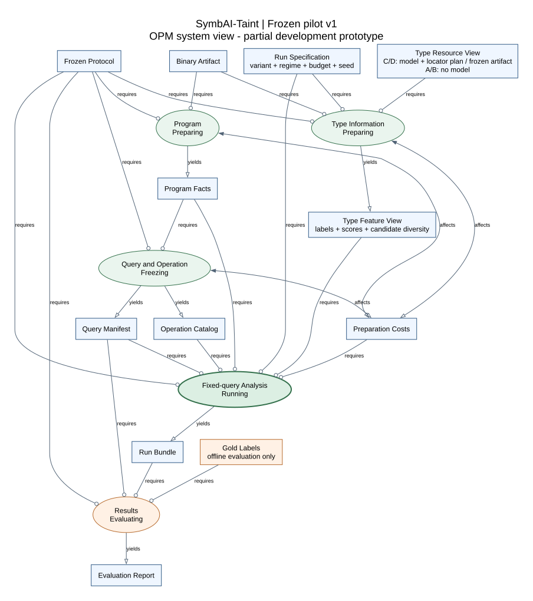

# SymbAI-Taint: Property-Directed Analysis Scheduling

[](LICENSE)


Code, experimental protocols and evidence notes for an academic study of which
local program-analysis operations to run under a limited computation budget.

## Overview

Binary program analysis can use several checks to answer the same scoped
property query. Some checks are cheap but incomplete. Others cost more and
may resolve queries that the cheaper checks leave open. SymbAI-Taint asks
whether pretrained neural type predictions help choose the next check.

The selector ranks operations using structural information and, when assigned
to a neural arm, types from a frozen TYGR/GlowGNN checkpoint. The checker uses
program semantics and explicit query assumptions, and fresh validation checks
decisive evidence. The offline evaluator reads the reference labels.



## Main contributions

1. **Controlled scheduling protocol.** The same selector, policy parameters,
   operation catalog and checkers support type-blind, Top-1 and scored Top-K
   comparisons. The fixed-order arm provides a separate baseline.
2. **Scoped evidence and cost accounting.** The runner records the query,
   decisions, timeouts and separate acquisition and analysis costs.
3. **Audited model integration.** An external adapter repairs DWARF4 location
   ranges in the isolated TYGR runtime. Guards validate native graph inputs and
   export the actual logits of the frozen 75-class checkpoint.
4. **Route B evaluation.** A new panel of six authored programs compares
   precomputed Top-1, an unscored Top-K set and scored Top-K with the same
   type-blind selector. Its decision rule comes before any gated acquisition work.

## Key results

| Question | Verified observation | Evidence |
|---|---|---|
| Can the model run on the compiled development panel? | v22.1 obtained output for 3/3 functions in one ELF, with seven variable records and three guarded forwards. | [Acquisition audit](docs/pilot_evidence.md#v221-successful-wsl-repair-audit) |
| Can those predictions distinguish the table-query pair? | Both queries yielded identical actual model inputs and all 75-class output rows despite different analysis-operation outcomes. | [v23 comparison](docs/pilot_evidence.md#v23-retained-type-information-collision-audit) |
| How costly is acquisition? | Cold acquisition took 8.305 s. A historical fixed cascade recorded 2.162 s for its three-query total in a separate run. | [Cost interpretation](docs/STATUS.md#current-checkpoint) |
| Is the Route B panel ready? | The local source reference passed for all 256 inputs in each of six programs. Native acquisition and paired neural results are pending. | [Route B pilot](benchmarks/selective_analysis/route_b/README.md) |

The project's main research questions remain open. **RQ1** asks whether neural
information improves the same scheduler under an equal end-to-end budget.
**RQ2** asks whether the candidate set and its scores add value beyond Top-1.

## Installation

For the model-free pilot, use a Python environment with the
[minimal requirements](benchmarks/selective_analysis/requirements.txt).
The documented Windows stack uses Python 3.13.10 and angr 9.2.217. Native
GlowGNN acquisition uses the original TYGR stack in an isolated WSL environment.
The Route B pilot runs on CPU. See [runtime compatibility](docs/VERSION_COMPAT.md).

```bash
python -m pip install -r benchmarks/selective_analysis/requirements.txt
```

## Data

| Panel | Where to find it | Purpose |
|---|---|---|
| Twelve generated ELF mechanisms | `benchmarks/selective_analysis/mechanisms.py` | Development fixtures for the original A–D runner. |
| Compiled integration and typed readiness | `benchmarks/selective_analysis/compiled_queries/`, `typed_complementarity/` | Workload-specific mapping, acquisition and operation checks. |
| Route B pilot | `benchmarks/selective_analysis/route_b/` | Six new authored programs and twelve fixed queries, grouped by program. |

The repository contains source fixtures and offline reference labels. Obtain
the pinned TYGR checkpoint and upstream source separately. Historical raw
receipts stay in local storage, with their identities recorded in the
[evidence log](docs/pilot_evidence.md). The [reproducibility guide](docs/REPRODUCIBILITY.md)
describes what can run from a clean checkout.

## Reproducing the experiments

Use the repository root as the working directory. The development workspace
keeps generated files under the parent directory's `.scratch/selective_analysis/`.

| Check | Command | Runtime |
|---|---|---|
| Route B source reference | `python -B scripts/run_route_b_pilot.py --reference-only` | Windows or WSL, GCC |
| Route B grouped information comparison | `python -B scripts/run_route_b_pilot.py` | WSL `angr-env` plus original CPU `tygr-orig` |
| Original model-free pilot | `python -B scripts/run_selective_pilot.py --make-mechanisms --variants A B --budgets 1` | Python with angr |
| OPM contracts and rendering | `python -B scripts/validate_architecture.py --render` | Python and Graphviz |

See the [Route B protocol](benchmarks/selective_analysis/route_b/README.md) for the
decision rule and the [pilot guide](benchmarks/selective_analysis/README.md) for
the original runner and its offline evaluation command.

## Verification

- **Source reference.** The Route B runner checks the full declared input range
  with independently compiled reference executables before collecting type data.
- **Decision checks.** Decisive analysis results require fresh validation within
  the query scope. Type input affects priorities only.
- **Artifact checks.** The guarded model path preserves source/model hashes,
  location traces and logits. The local v23 synchronization passed 1,285 tests
  and validated 22 OPM views. See the [verification record](docs/VERIFICATION.md).

## Limitations

The verified neural results so far are development observations. Route B uses six
separately compiled authored programs with a shared harness, and its two queries
per program share a neural record. The type interface relies on DWARF locations.
Scores are uncalibrated. Each decision covers a declared first-visit write query
under modeled assumptions. The project has yet to demonstrate neural scheduling
benefit or generalization to independent real projects.

## Repository structure

```text
src/selective_analysis/            Query contracts, checkers, selectors and evidence
benchmarks/selective_analysis/     Developer fixtures and run guides
  route_b/                         New program groups and offline reference labels
scripts/                           Experiment and validation entry points
docs/architecture/                 OPM DOT sources, SVGs and frozen specifications
docs/pilot_evidence.md             Chronological evidence and receipt identities
tests/                             Contract, analysis and reproduction checks
```

The [documentation map](docs/README.md) links the current guides and earlier
experiments on the separate legacy pipeline.

## Citation

Cite the [SymbAI-Taint repository](https://github.com/witold-andelie/SymbAI-Taint)
and the specific commit or experiment protocol used.

## License

Project source is distributed under the [Apache License 2.0](LICENSE).
