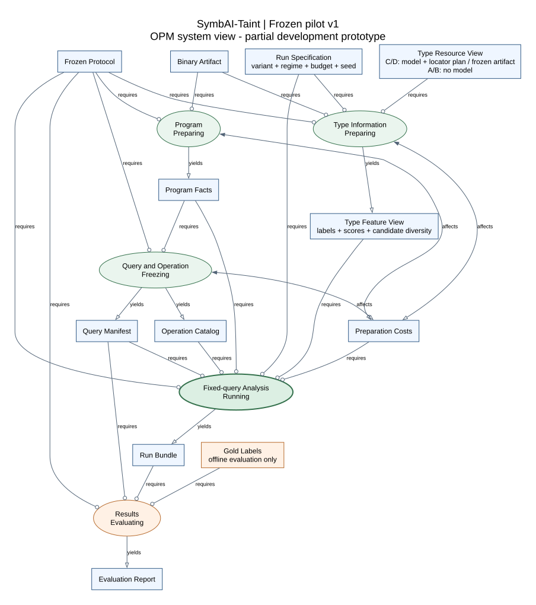

# SymbAI-Taint: Property-Directed Analysis Scheduling

SymbAI-Taint is an academic research prototype for binary program analysis. It asks
whether pretrained GNN type information can help choose useful local symbolic-analysis
operations under a limited total computation budget.

The active pilot is separate from the earlier 13-stage taint-analysis pipeline. It uses
frozen TYGR/GlowGNN predictions and angr-based checks; it requires neither new neural
training nor an LLM. Neural predictions guide priorities and never become trusted solver
facts or justify discarding a program path.

## Research questions and architecture

- **RQ1:** Under an equal end-to-end budget, does neural type information improve a
  property-directed scheduler compared with the same scheduler without type information?
- **RQ2:** Do multiple candidate types and their model scores add value beyond a single
  predicted type label?



The same query, program facts and operation catalog enter each comparison. A shared
scheduler selects local checks, a separate validator checks decisive evidence, and an
offline evaluator reads the gold labels. Model scores are not calibrated correctness
probabilities.

| Variant | Scheduling | Type input |
|---|---|---|
| A | Fixed order | None |
| B | Shared selector | Hidden |
| C | Same selector and parameters | Genuine Top-1 label |
| D | Same selector and parameters | Genuine Top-K candidates and raw scores |

B/C/D keep non-type features, candidate operations, checkers, stopping rules and budget
accounting identical. Information-only ablations isolate the input's value; end-to-end
comparisons charge acquisition, mapping, preprocessing, selection, checking and validation.

The [architecture](docs/architecture.md), [OPM DOT profile and views](docs/architecture/README.md)
and [executable protocol](benchmarks/selective_analysis/README.md) define the boundary.
The diagrams use an explicitly limited OPM rendering profile, not a full executable OPM model.

## Current evidence: development v23, 13 November 2026

The protocol was frozen on 10 November. Development revisions record engineering and
diagnostic gates; they do not establish a new algorithm or a successful research result.

| Verified observation | Meaning and limit |
|---|---|
| Corrected WSL acquisition covers 3/3 authored functions in one ELF | Seven genuine variable outputs, eleven readout rows and three guarded forwards; these are not independent benchmark samples. |
| The two table queries have identical actual model inputs and all 75-class output rows | Their historical operation capabilities differ. This representation alone cannot distinguish that pair; structural evidence and adaptive fallback remain possible. |
| Cold acquisition took 8.305 s | The earlier three-query fixed-cascade total was 2.162 s in another run/stage. These are descriptive costs, not a paired speed comparison. |
| Local validation: 1,285 passed; public export: 1,273 passed, 12 optional skips; 22 OPM views validated | Software and contract checks, not evidence of neural benefit or whole-program correctness. See the [verification record](docs/VERIFICATION.md). |

**Neural scheduling benefit, calibrated uncertainty, independent generalization and a
publication-level algorithm contribution remain unproven.** The current location interface
is DWARF-assisted; no end-to-end fully stripped type-recovery claim follows.

See [current status](docs/STATUS.md) and the
[v23 evidence entry](docs/pilot_evidence.md#v23-retained-type-information-collision-audit).
The evidence log indexes retained local artifacts; raw bundles and pretrained weights
are not included in this repository.

## Run the small developer pilot

Use an existing environment with the dependencies in
[the pilot requirements](benchmarks/selective_analysis/requirements.txt).
The authored mechanisms need no model, GPU or API. From the repository root in PowerShell:

```powershell
py -3 -B scripts/run_selective_pilot.py --make-mechanisms --variants A B --budgets 1 --output D:/AI_Models/symbolic/.scratch/selective_analysis/my-pilot
py -3 -B scripts/evaluate_selective_pilot.py --runs D:/AI_Models/symbolic/.scratch/selective_analysis/my-pilot/runs.json --gold D:/AI_Models/symbolic/.scratch/selective_analysis/mechanisms/gold.json --output D:/AI_Models/symbolic/.scratch/selective_analysis/my-pilot/evaluation.json
```

Use a fresh output directory. The default scratch root is outside the checkout, on D:
in the development workspace. See [reproduction tiers](docs/REPRODUCIBILITY.md) before
changing paths or running optional native-model commands.

The primary panel contains twelve tiny authored x86-64 ELF mechanisms. Each query declares
object bounds, input assumptions and first dynamic target-write scope. Outcomes are
`violation`, `excluded_within_scope` or `unknown`. A modeled witness is rechecked in a
fresh model; native input replay is not implemented. A scoped exclusion does not prove
the entire program correct.

C/D require separately obtained upstream source, the pinned model, a compatible runtime
and accepted location mappings. Missing information remains unavailable/unknown; fabricated
scores and legacy constant confidences cannot substitute for genuine model output.

## Validate and navigate

```powershell
$env:PYTHONDONTWRITEBYTECODE='1'
$env:PYTEST_DISABLE_PLUGIN_AUTOLOAD='1'
py -3 -B -m pytest tests -q -p no:cacheprovider --basetemp=D:/AI_Models/symbolic/.scratch/selective_analysis/pytest-public
py -3 -B scripts/validate_architecture.py --render
```

Run the `tests` directory explicitly. Upstream TYGR's command-line test modules are not
part of this suite. Graphviz is needed for rendering; the checked-in SVGs can also be
viewed directly. Optional upstream-source/model checks skip when their artifacts are
absent; available but invalid artifacts still fail validation.

- [Documentation map](docs/README.md): current guides, frozen specifications and historical records.
- [Reproducibility](docs/REPRODUCIBILITY.md): clean checkout versus local receipt replay.
- [Runtime compatibility](docs/VERSION_COMPAT.md): measured Windows/WSL and isolated TYGR environments.
- [Development evidence](docs/pilot_evidence.md): observations, failures and corrections.
- [Legacy implementation](docs/INTERNAL.md): earlier `src/pipeline.py` integration.
- [Research write-up boundaries](docs/PAPER_MATERIAL.md): supportable claims and missing experiments.

The earlier pipeline and Juliet results remain historical implementation records. Their
metrics use a different protocol and cannot answer the frozen RQ1/RQ2.
