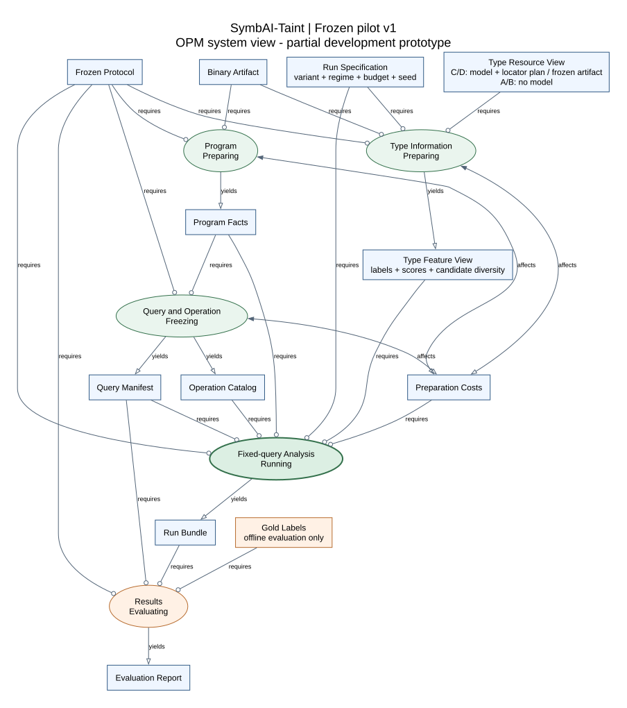
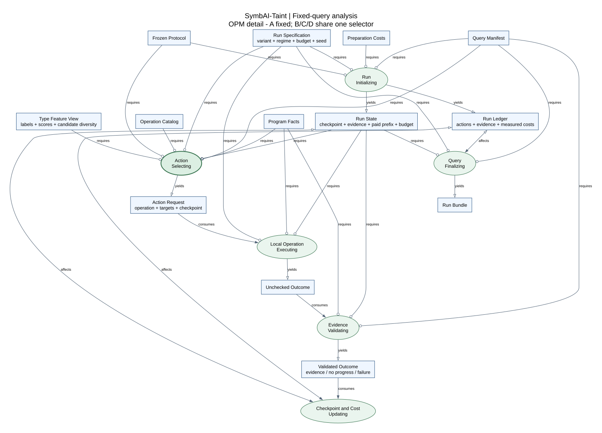
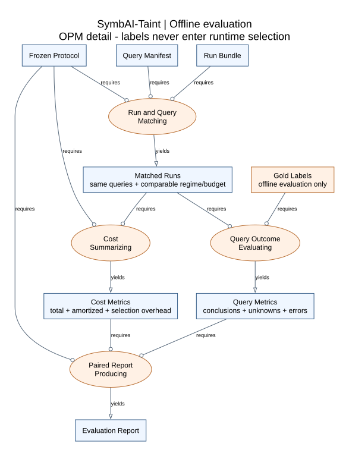

# Frozen architecture: property-directed analysis scheduling

**Decision:** frozen pilot v1, 10 November 2026.

**Implementation status, 13 November 2026:** partial, executable research prototype.
Shared selection, local checks, evidence records, isolated budgeted runs and guarded
genuine TYGR acquisition are implemented. The latest completed checkpoint is v23;
neural scheduling benefit and independent generalization remain unproven. The active
location interface is DWARF-assisted. [Current status](STATUS.md) summarizes the results;
[reproducibility](REPRODUCIBILITY.md) separates public mechanisms from local receipt replay.

**Current development revision:** [v23: retained type-information collision audit](architecture/pilot_revision_v23.md).
The corrected native acquisition covers all three functions. Exact prepared/collated
inputs and all 75-class output rows coincide for the two table queries; their historical
operation capabilities differ. This audit does not introduce a selector or establish
information value. See [the OPM view](architecture/type_information.svg).
The corrected [v22.1 compatibility repair](architecture/pilot_revision_v22_1.md)
reuses the v21 ELF and admits genuine output for 3/3 functions (seven variables, eleven
readout rows, three guarded forwards). The earlier v21 acquisition covered 1/3, and
the first [v22 repair](architecture/pilot_revision_v22.md) failed admission; those are
historical attempts. The successful repair leaves original TYGR/model unchanged and
does not introduce a scheduling algorithm or demonstrate neural benefit.
See [the OPM view](architecture/location_repair.svg).

## Development checkpoint history

The following stage-specific observations retain their original experimental scope.
They are not new independent samples or the current task list. The first real charged
end-to-end probe resolved one query with B in about 1.2 s; C/D took 5.8-6.5 s and timed
out at 3 s. [Its evidence](pilot_evidence.md#first-real-end-to-end-run) remains unchanged.

Retaining [v21: compiled typed-complementarity readiness](architecture/pilot_revision_v21.md),
retaining [v20's native readout group and frontier correspondence](architecture/pilot_revision_v20.md),
retaining [v19's native preprocessing capture without prediction](architecture/pilot_revision_v19.md),
with [the post-capture encoder erratum](architecture/pilot_revision_v19_erratum.md),
retaining [v18's frozen model-interface audit](architecture/pilot_revision_v18.md),
retaining [v17's instruction-level syntax provenance](architecture/pilot_revision_v17.md),
retaining [v16's information readiness and trace-cost gate](architecture/pilot_revision_v16.md),
retaining [v15's complete fixed cascade](architecture/pilot_revision_v15.md),
retaining [v14's readonly-indirection mechanisms](architecture/pilot_revision_v14.md),
retaining [v13's negative routing-sensitivity result](architecture/pilot_revision_v13.md),
retaining [v12's static location correspondence](architecture/pilot_revision_v12.md),
retaining [v11's operation evidence/applicability](architecture/pilot_revision_v11.md),
retaining [v10's batch accounting and guard](architecture/pilot_revision_v10.md),
retaining [v9's archived restricted-frame results](architecture/pilot_revision_v9.md),
retaining [v8's two compiled developer queries](architecture/pilot_revision_v8.md),
retaining [v7's independent operand mappings](architecture/pilot_revision_v7.md),
retaining [v6's information diagnostic](architecture/pilot_revision_v6.md),
[v5's acquisition profiler](architecture/pilot_revision_v5.md),
[v4's separate operation-choice controls](architecture/pilot_revision_v4.md) and
the frozen A-D behavior from [v3](architecture/pilot_revision_v3.md) and
[v2's exact-prefix reuse and candidate features](architecture/pilot_revision_v2.md).
Dependency preparation supplies query-bound execution snapshots to later checks.
All final validation starts fresh. Candidate identities, logits and conditional diversity
remain visible to the common selector; they do not become solver assumptions.

V12 isolates a new correspondence interface from the old target-semantic operand proofs.
It associates raw function/CFA/PC metadata with syntactic stack-load contributions to the
declared write address. Matching never reads names, labels or scores; it executes no
program and proves no object, index or bounds relation. Candidate views remain separate
per load occurrence, without semantic base/index roles. Unsupported or ambiguous inputs
retain unavailable records. This diagnostic uses only the same three compiled integration
inputs and frozen raw exports; neither the frozen selector nor its property checker changes.
See the [OPM view](architecture/location_correspondence.svg).
Windows and WSL now produce identical six bindings, static traces and normalized candidate
views from the same source/input identities. This closes the restricted location-interface
gate; useful operation tradeoffs and incremental neural information remain unproven.

The separate v13 diagnostic uses the existing frame/full operation alternatives, one
shared B/C/D policy and identical type-blind features. It scans a fixed five-weight grid,
retaining per-occurrence C/D views and complete operation orders. All three known inputs
have identical B/C/D orders throughout the grid. Disjoint pointer/integer label support
and genuine conditional scores can change this policy on fabricated unit inputs, so
the real agreement is not a disabled feature. The mask baseline is deliberately strong;
agreement there is structurally forced and does not establish general neural redundancy.
This stage executes no property checker or new model. See [the OPM view](architecture/routing_sensitivity.svg)
and [the bounded conclusion](pilot_evidence.md#v13-routing-sensitivity-gate).
The WSL audit now reproduces all policy/features/view identities, scores, geometry and
orders with the same ten measured sources and original inputs. Timing and environment
metadata remain separate. The gate is complete on these known integration inputs; a
future study requires an operation-specific type-information hypothesis rather than
more weight scanning on this panel.

V14 implements a bounded finite-register domain with readonly qword loads and complete
small-mask transfer. It rejects mutable, unbacked, wrapping or relocation-affected reads;
cardinality overflow becomes Top, never sampling. An abstract exclusion needs all target
spans inside bounds and a fresh byte/data recheck. A separate three-input authored panel
now demonstrates the scalar-range/readonly-chain capability tradeoff and a conservative
unsafe control. Twelve actual method runs include an interval-then-finite fixed fallback.
Independent reference workers run only afterward, using literal BVV input-domain enumeration
where small and symbolic complete-scope checking otherwise. This is not a new VSA theory,
neural scheduling result or independent evaluation. The [OPM view](architecture/indirection_gate.svg)
keeps gold isolated and reference cost separate. See [the evidence](pilot_evidence.md#v14-readonly-indirection-mechanism-gate).
The WSL audit now reproduces all twelve measured sources, query/binary identities,
abstract outcomes/certificates, fallback sequences and reference domains/statuses. Full
checking and interval-then-finite each settle two queries, but different subsets, so their
total times are not a matched-quality speed comparison.

V15 now executes that strong control: interval, finite readonly, then expanded checking,
with fresh entry state for every attempt and a single parent-owned query budget. A
validated decisive result stops the sequence; unknown or failed attempts remain paid.
The parent clock includes complete detailed trial-payload persistence and emits a separate
final receipt, with its work explicitly excluded. Worker runtime versions are observed,
not inferred from the auditor. See the [OPM view](architecture/fixed_cascade.svg).
Three Windows repetitions correctly resolve all three known queries with the cascade,
versus two with expanded-only. Three new label-free references agree. The eighteen trial
records remain three unique authored mechanisms. Only matched correct query/repetition
pairs enter timing summaries. Per-query method order is not fully counterbalanced, so
there is no stable speed claim. WSL now reproduces all eighteen outcomes and operation
sequences, abstract certificates and fresh reference coverage with identical sources and
inputs. Actual worker versions and timing remain separate; the unsafe cascade is slightly
slower in every WSL pair. A later neural selector must
beat this actual fixed baseline and structural/cardinality routing controls while paying
for its information. See [the WSL audit](pilot_evidence.md#v15-wsl-fixed-cascade-replication).

V16 is entirely offline. It verifies existing raw-logit/ranking and recorded location-bundle
identities, inspects ELF section metadata, recomputes the complete v15 evaluation and
accounts for a hindsight deletion of unknown attempts while holding all other costs fixed.
The two existing panels have zero exact mapped-query intersection. Sectionless v14/v15
mechanisms cannot use the current DWARF locator/CFA-frame mapper; the upstream action
summary also lacks reliable instruction/overwrite identity for a direct register bridge.
The nine WSL traces contain only 0.420041 s of optimistically deletable unknown-attempt
time. Shared imports can move to the retained operation, so this is not an unconditional
real-runtime saving bound. Historical cold acquisition remains separate context for a
different binary, without cross-panel subtraction. No new model, mapper, graph, operation
or type-aware schedule executes. See the [OPM view](architecture/information_readiness.svg)
and [audited conclusion](pilot_evidence.md#v16-information-readiness-and-trace-cost-gate).
RQ1/RQ2 remain unanswered. A new bridge needs instruction/read-write/width/overwrite
provenance and a concrete potential signal beyond structural load/cardinality controls;
current known-case coverage alone does not justify a learned policy.

V17 implements a separate model-free provenance representation. Single-instruction
PyVEX lifting and Capstone boundary checks retain every temporary read/definition and
event-time register-byte source. Puts update exact spans; intermediate reads never use
final-state register values. Ordinary loads remain opaque, and current-address affine
normalization stops at current Gets before comparing the restricted Capstone address form.
Requests omit object/capacity/input-range/type/label parameters. Parent validation replays
byte versions/temp scopes and verifies the complete graph before accepting availability.
The unchanged three original binary/query hashes are pinned in the separate runner.

Windows validates all three syntax graphs and both intermediate/overwritten RAX pairs.
The safe/outside graphs are identical because readonly contents are not evaluated. This
does not validate TYGR's feature/readout context or provide a type-aware scheduling result.
No existing graph/exporter/checker changes. WSL now reproduces all nine source hashes,
four input hashes and all three complete graph objects, not just graph sizes. Node/edge,
byte-version, temporary and address-binding fields match exactly while actual runtime
versions and diagnostic costs remain separate. Further neural work still needs both
readout compatibility and an information-value mechanism beyond
static load/cardinality controls. See the [OPM view](architecture/instruction_provenance.svg)
and [WSL audit](pilot_evidence.md#v17-wsl-instruction-provenance-replication).

V18 passively reads the pinned checkpoint with a bounded symbolic pickle interpreter.
Saved globals, reductions and BUILD states remain data; no framework/model class or
tensor array is loaded. The 31-feature encoder and 75-class decoder shapes agree, but
the saved ordered preprocessing vocabulary yields 60 directional IDs while all eight
saved RGCN layers and their coefficient matrices have capacity 44. IDs 44–59 are outside
that layer domain. Actual historical prepared IDs are unavailable, so this establishes
a domain-coverage constraint rather than proving old edge usage or forward failure.

The three v17 graphs retain 259 nodes, including 38 syntactic literal candidates and
221 nonliteral nodes without the upstream value contract. All 238 dependencies and
twelve address-readout candidates lack declared trained projections. Constants alone
do not supply upstream annotation/context semantics. No zero-filled value, unknown-edge
fallback, arbitrary readout or feature tensor is created. Direct bridging stays not ready.
Before another prediction, establish the trained relation-ID contract and complete
value/context/readout provenance, then test conditional information value against strong
controls. See the [OPM view](architecture/model_interface.svg) and
[independent audit](pilot_evidence.md#v18-frozen-model-interface-audit).

[Development v3](architecture/pilot_revision_v3.md) adds acquisition inside the same cold-query
budget while retaining the v2 selector and operations. It uses fresh per-run exports and
a fixed, reviewed locator plan, not precomputed type scores.

The [operation-menu audit](architecture/operation_selection_gate.md) led to separate v4
diagnostics. A byte-decoded local interval check can settle four of the existing twelve
mechanisms without loading angr. On three Windows repetitions, a fixed cheap-first fallback
retained all conclusions with 30.7% less total wall time than expanded-only. WSL replicated
the same queries and sources with 23.4% lower total wall time. Both are non-neural developer
results. Failed cheap attempts total only 1.255 s across 24 WSL fallbacks, so skipping them
alone leaves little time to repay neural acquisition. Evidence that type information
improves the choice remains outstanding. No A-D operation or weight was changed.

The opt-in v5 profiler now separates imports, model loading, graph/location generation,
preprocessing, collation, model forward, export and serialization. It reuses the existing
reviewed probe for three cold acquisitions. Real WSL measurement now validates the stage
receipts: imports dominate, graph generation takes about a second and forward about 0.09 s.
The total median is 5.154 s. This
instruments Type Information Preparing and its paid costs in the existing OPM system view;
it does not change the modeled A-D interfaces or create a warm-inference accounting unit.

The v6 diagnostic compares frozen A-D type views and both fixed controls after common
checker preparation, using one checked v5 type artifact. Its 54-record Windows run found
no extra conclusion for C/D; all methods resolved the query at 0.5 s. Windows finalization
dominated part of the lower-budget results. This is one-query information-only evidence,
not end-to-end benefit or generalization. WSL replicated the same inputs and conclusion:
at 0.5 s all methods resolve it, with B 0.268 s, C 0.413 s and D 0.414 s median charged time.
The [input-scope audit](pilot_evidence.md#v6-wsl-replication-and-input-scope) identifies a
remaining boundary: only the base-pointer prediction is projected, although the write
address also depends on an index with a separate raw prediction. Operand-qualified type
views and independent mapped queries were identified as prerequisites for further work.

The v7 mapper now gives this query distinct base-pointer/index IDs and separately projects
their raw candidates. Two fresh symbolic passes verify the slot anchors, address sum and
constant byte length without reading type labels. Common facts are exported separately
for all future arms; A/B expose no type view, C hides scores per role and D retains each
role's own scores. The original selector and v6 input remain as recorded. Windows and WSL
validated the two operands of this one query with matching canonical bundles and program
evidence. Independent coverage and role-aware scheduler integration remain pending.

V8 implements a separate two-query entry for affine-offset and masked-index writes.
It compiles the frozen C sources, extracts a label-free query, acquires one fresh CPU
TYGR export per binary and enumerates two physical base/index assignments. The index
expression is a claim to prove, never an added solver assumption. Acceptance requires
one verified assignment, explicit rejection of its alternative and a fresh recheck.
Property validation proceeds independently of neural acquisition success. All planned
cases remain in the offline denominator. Genuine WSL validation now passes on both
binaries, with one modeled violation and one complete scoped exclusion. The audit
verifies all 21 source/specification hashes, raw-logit aggregation, physical assignments
and fresh result validation; Windows independently reproduces the program evidence.
There are now three compiled developer queries with two mapped operands each, including
the original probe. They are not held-out projects. No role-aware selection or new neural
gain is claimed. A separate post-hoc applicability check finds that the eight-step
operation cannot reach either new target and the local-bound checker rejects their
`push` prologues. This motivates the separate v9 operation rather than a selector change.

V9 obtains a unique entry RSP from a freshly constructed reference state and checks that
its bounded stack window is disjoint from the image and declared object. It propagates
intervals through a restricted straight-line compiler frame and initialized aligned
eight-byte RBP slots. Other memory, partial overlaps, pointer escapes, calls and branches
remain unknown. A decisive exclusion requires fresh entry-context and byte-decoded
rechecking; all preparation and validation are paid. A fallback reuses the paid project
but starts a fresh symbolic state with no prepared-prefix reuse. The old v4 checker and
A-D selector/catalog remain unchanged.

All 172 tests pass. On the same three compiled developer queries, 27 Windows records
show the new checker discharging only the masked case (3/9 repetitions), with no wrong
decisions. Full checking and frame-first fallback both resolve 9/9 repetitions correctly,
at total wall costs 17.217 s and 17.121 s. This small difference does not establish a stable
speed advantage or neural information value. WSL replicated all conclusions and source/input
identities. Its 10.610/9.214 s full/fallback totals are influenced by the first full run
(2.732 s), while its medians are 0.978/1.030 s. Only that first matched pair favors fallback;
the other eight do not. All original records remain included. Cost batching should be
diagnosed before advancing the selector. These remain three unique queries, not 27
independent samples.

V10 uses one cold worker for a batch of the same three queries, charging startup,
checking, fresh validation, recovery and initial receipt generation to a 15 s batch
budget. Projects and explicit analysis state remain fresh per query; imports and ordinary
library caches may warm within the batch. The primary cost is the complete batch, not
the sum of free-start query durations. All planned identities survive failures and late
parent finalization demotes decisive results to unknown while retaining their evidence.

Independent review also reproduced a nonstandard ELF where dynamic relocation tables
changed loaded instructions that the file-byte checker did not see. V10 rejects uncovered
or unsupported relocation layouts, checks complete executable write spans and compares
frame-decoded instruction bytes with the actual reference image. This is a conservative
correctness revision, not a neural contribution. Archived v9 sources/results remain
unchanged; its ordinary GCC query facts were independently verified. Current operation
revision markers distinguish the corrected implementation.

All 253 tests pass, including the reproduced layout regression and batch deadline/recovery
tests. The primary Windows run has nine batches and 27 outcomes on three unique inputs:
full and fallback each retain 9/9 correct repeated outcomes at total batch costs 6.214 s
and 6.096 s. The changed unit and correctness guard prevent treating v9-v10 as a matched
algorithm comparison. WSL has now replicated the source/query protocol, all 27 outcomes
and the corrected proof semantics. Total full/fallback batch costs are 4.770/3.835 s,
while medians are 1.239/1.292 s. The first full batch is the sole matched pair favoring
fallback. Post-hoc removal of that pair from both methods reverses the aggregate sign;
every primary record remains retained. No stable speed or neural gain is established.
The accounting infrastructure is ready for operation-value feasibility work; these
three developer inputs do not justify a more elaborate neural selector by themselves.

V11 retains all twelve generated mechanisms and starts every probe from a canonical
empty function-entry checkpoint. Five probes compare bounded/full checking, RDA-plus-full,
direct-prefix-plus-full without RDA, and corrected local bounds. Each alternative pays
its own required setup, preparation and fresh validation; shared worker/feature costs
are retained separately. Dependency graphs and snapshots are planning artifacts, not
validated query decisions. Operation-local costs are not deployed-policy timings.

The 180-row Windows run has no wrong validated decisions. Bounded/full share 33 correct
answers with equal observed executed steps. Both prefix composites preserve total
execution work on all 36 pairs each; RDA composite median costs exceed both full and
direct-prefix medians on every query. Local bounds excludes four of twelve inputs.
All 375 tests pass. WSL now replicates all 180 records, empty checkpoints, decisions and
observed execution work under the same 26 source/specification hashes. RDA composite
median costs are higher than both full and direct-prefix costs on every input in both
environments. These are operation-local diagnostics, not policy throughput.

The separate compiled integration audit conditionally derives all three answers from
the existing paid operand proofs and declared bounds, without reading neural candidates
as decision evidence. Existing frozen runs did not consume these complete facts, so this
is a prospective free-proof issue, not evidence of leakage in prior A-D results. Later
experiments must use a location-only correspondence or charge semantic mapping proof
and include its facts-to-decision baseline. These three inputs cannot demonstrate an
extra neural scheduling contribution after their answers are already available.

**Canonical models:** [system DOT](architecture/system.dot), [scheduler DOT](architecture/scheduling.dot), [evaluation DOT](architecture/evaluation.dot).
The separate [v4 diagnostic DOT](architecture/operation_controls.dot) and
[SVG](architecture/operation_controls.svg) describe the fixed operation controls.
The [v6 information DOT](architecture/information_value.dot) and
[SVG](architecture/information_value.svg) show its excluded preparation and paid analysis.
The [v7 mapping DOT](architecture/operand_mapping.dot) and
[SVG](architecture/operand_mapping.svg) separate program evidence from candidate binding.
The [v8 compiled-query DOT](architecture/compiled_queries.dot) and
[SVG](architecture/compiled_queries.svg) show the separate acquisition/validation track.
The [v9 frame-check DOT](architecture/frame_bounds.dot) and
[SVG](architecture/frame_bounds.svg) make paid entry context and fresh rechecking explicit.
The [v10 batch DOT](architecture/frame_batch.dot) and
[SVG](architecture/frame_batch.svg) show the full batch clock and partial-result recovery.
The [v11 operation-evidence DOT](architecture/operation_effects.dot) and
[SVG](architecture/operation_effects.svg) separate planning, validated decisions and the
post-hoc paid-proof panel. Model checks reject proof routes into pre-action runtime.

**Historical implementation:** [v13 architecture snapshot](archive/architecture_v13.md).

The research unit is a fixed binary program-property query. Frozen TYGR/GlowGNN predictions
provide optional information for selecting local analysis operations. An unchanged symbolic
checker evaluates those operations using program semantics. The pilot tests the value of
type information in scheduling; it does not require neural predictions to modify the
checker, introduce assumptions, remove paths, or change the candidate operation universe.

## Frozen questions and scope

- **RQ1:** Under an equal end-to-end computational budget, does neural type information
  improve property-directed analysis scheduling compared with the same scheduler without it?
- **RQ2:** Do multiple candidate types and their model scores provide additional scheduling
  benefit beyond a single predicted type label?
- **Input:** x86-64 ELF; first property family: buffer writes and bounds.
- **Model:** frozen pretrained TYGR/GlowGNN; no new neural training or LLM is required.
- **Operations:** begin with two or three bounded, independently executable operations,
  chosen from use-site definition recovery, local points-to checks, bounded calling-context
  inspection, and IR/type compatibility checks. Each operation must have a semantic contract.
- **Development:** 10-12 mechanism cases, followed by independent held-out cases. These
  development examples do not establish generalization or publication readiness.
- **Resources:** one RTX 3090, at most 100 GB host RAM, approximately one week of rented
  compute after local prototype validation. Timeouts and concurrency are configured from
  measured small-run costs, not assumed from this hardware description.

The earlier complete type/rule joint-inference proposal is background, not a pilot requirement.
Group selection, learned utility models, joint feedback, and LLM adjudication remain later
research options. The freeze is an experimental protocol, not a claim of algorithmic novelty.

## OPM model

Here OPM means **Object-Process Methodology**. DOT is the repository's textual serialization
of a documented OPM subset; it is not an OPCAT/OPCloud interchange format or a claim of
complete ISO conformance. Objects are rectangles, processes are ellipses. Immutable inputs
are instruments, temporary requests can be consumed, new records are results, and mutable
runtime objects can be affected. Labels and the `relation` attributes specify link semantics.

The three views are linked by stable node IDs and `refines` metadata. They show conceptual
relationships, not executable control-flow graphs. Numerical guards, stop conditions, and
alternative variant modes are specified below rather than inferred from graph layout.



| View | Purpose |
|---|---|
| [System](architecture/system.dot) | Separate program preparation, optional neural information, runtime analysis, and offline evaluation. |
| [Scheduling](architecture/scheduling.dot) | Refine `AnalysisRunning`: select, execute, validate, update state, and finalize query results. |
| [Evaluation](architecture/evaluation.dot) | Refine `ResultsEvaluating`: match fixed queries, account costs, and produce paired comparisons. |

See [the DOT notation and validation guide](architecture/README.md) for link encodings,
OPL statements, rendering commands, and the limits of the structural validator.

## Components and implementation boundary

The OPM models specify the target boundary. The implementation below is intentionally
narrower: manually declared object bounds, one fixed write instruction, its first dynamic
visit, ordinary VEX stores and a small fixed operation catalog. It does not yet implement
automatic object recovery, general points-to refinement or debug-independent type mapping.

| Responsibility | Implementation | Current boundary / remaining work |
|---|---|---|
| ELF loading, lifting and CFG | `src/binary_analysis/`, angr | Reuse within an explicitly declared model and supported instruction scope. |
| Local dependencies | `src/selective_analysis/dependencies.py` | Temporary-aware definitions, explicit edges and a local backward slice plan; local approximation, not proof of relevance or complete alias coverage. |
| Neural candidate extraction | `scripts/export_tygr_candidates.py` | Real 75-class logits exported on one compiled DWARF-assisted fixture; original node order and score provenance retained. Legacy fixed `0.9` is not accepted for D. |
| Online acquisition and lifecycle | `src/selective_analysis/online_types.py`, `processes.py` | Fresh per-query export, identity checks and bounded worker groups exercised in WSL on one query; no neural net benefit observed. Prior human mapping review remains an explicit setup input. |
| Prediction/use-site mapping | `scripts/map_tygr_candidates.py`, `src/selective_analysis/types.py` | One base-pointer mapping checked through assembly and fresh symbolic-state relations; no general automatic mapping or debug/stripped identity transfer. |
| Fixed queries and operation contracts | `src/selective_analysis/contracts.py` | Strict hash-qualified queries, input ranges, declared bounds and three type-blind operations. |
| Shared deterministic selector | `src/selective_analysis/scheduler.py` | One score and decision function for B/C/D, structural features and optional type features; developer heuristics, not a validated novel algorithm. |
| Local checks and evidence validation | `src/selective_analysis/operations.py` | Bounded exploration with optional reuse of a paid exact prefix, actual write-condition solving and fresh modeled reexecution; native input replay remains pending. |
| Records and accounting | `src/selective_analysis/runner.py` | Checkpoint/action/evidence/time records; peak-memory and GPU accounting remain pending. |
| A-D experiment runner | `scripts/run_selective_pilot.py`, `scripts/run_end_to_end_probe.py`, `scripts/evaluate_selective_pilot.py` | Cold subprocesses, whole-job deadlines, failure retention and offline labels. `--online-tygr` requests actual C/D acquisition; no configuration means unavailable. |
| Conservative local bounds | `src/selective_analysis/local_bounds.py` | Small unsigned x86 subset, interval overapproximation, exclusion certificates and fresh byte-decoded recheck; all other results remain unknown. Used only by separate diagnostic controls. |
| Operation-choice controls | `src/selective_analysis/controls.py`, `scripts/run_operation_gate.py` | Expanded-only, bounds-only and fixed bounds-first fallback compared with B on the same twelve mechanisms; cold-process costs and failures retained. No neural inputs or A-D catalog change. |
| Acquisition cost diagnostic | `scripts/profile_neural_acquisition.py`, optional exporter/provider profiling | Three genuine cold CPU acquisitions validated on the reviewed probe, with flat stage timings and identity-checked receipts. No persistent-service or neural scheduling benefit measured. |
| Information-value diagnostic | `src/selective_analysis/information_value.py`, `scripts/run_information_value.py` | Common symbolic/byte-checker preparation excluded for all methods; frozen B/C/D differ only in genuine type view. Same-source/input Windows and WSL runs show no extra neural conclusion on one query. Current projection covers only its base pointer. |
| Independent operand mapping | `src/selective_analysis/operand_mapping.py`, `scripts/review_operand_mapping.py` | New role-qualified schema, single-successor CFA/affine proof with fresh recheck, common candidate-free facts and separate C/D views. Two operands verified on one query in Windows and WSL; no selector integration or general automatic mapping claim. |
| Legacy full pipeline | `src/pipeline.py`, taint and LLM modules | Available as v13 background; legacy scores and templated prose are not pilot evidence. |

### Prerequisites discovered in v13

1. `dfg_construction.py` skips `RdTmp`, lacks normal `WrTmp` tracking, and scans basic blocks
   without a full reaching-definition join. It is not an authoritative relevance oracle.
2. `type_injector.py` already inserts GNN predictions into TypedIR, but block-level variable
   extraction remains a stub. A use-site mapping must be validated independently.
3. The current TYGR adapter locates variables through DWARF. A debug-assisted development
   setting must be declared as such. A binary-only result requires a working debug-independent
   locator and a separately identified evaluation track. Ground-truth types are not inputs.
4. `build_semantic_evidence()` emits template statements about satisfiability and bounds.
   These strings are not solver results. The pilot accepts structured results from actual checks.
5. The old Juliet GNN phase rechecks missed positives only. The pilot runs each method on
   the same query set without access to labels, and retains errors and timeouts.

## Frozen A-D protocol

| Variant | Selector | Type view |
|---|---|---|
| A | Fixed, predeclared operation order | None |
| B | Shared property-directed selector | None; type channel explicitly unavailable |
| C | The same selector as B | GNN Top-1 type label, without score |
| D | The same selector as B | GNN Top-K candidate labels and genuine model scores |

B/C/D share the selector implementation and frozen parameter values, non-type features,
query manifest, candidate operation contracts, checker, evidence validator, stop rules,
and budget accounting. Equal selection code need not make equal choices. The structural
part of the score remains meaningful when the type view is unavailable; it must not become
a deliberately crippled GNN-specific formula with zero-filled features.

An operation is `a = (G, precision_kind)`, where G is a local set of use sites. The initial
implementation may use singleton sets. Groups are admitted only if mechanism experiments
show a benefit beyond normal alias/identity canonicalization.

The shared selector has the form `choose(checkpoint, eligible_operations, structural_features,
type_view, budget)`. Optional type features may alter ranking, never the checker semantics
or the operation universe. Candidate eligibility can evolve from validated evidence and
declared preconditions, using the same rules in every variant at the same checkpoint.

A first score uses a documented deterministic structural utility term, an optional type term,
and an estimated full operation cost. Missing type information is represented by an explicit
availability flag. No numerical weights or performance improvements are asserted here;
they must be specified on development cases and frozen before held-out evaluation.

The selector never reads labels, expected answers, future action outcomes, test-set F1, or
unpaid oracle information. Rank changes are hypotheses about usefulness, not proof facts.
Neither Top-K truncation nor high model scores authorize excluding actual executions.

### Two budget regimes

**Information-only** experiments use identical precomputed program facts, operation contracts,
checkpoints and frozen type predictions. Feature views expose no types, a label, or candidates
and scores. This regime isolates information value; it does not establish deployment cost.

**End-to-end** experiments charge actual information acquisition and analysis costs, including
model loading/inference, mapping, dependency preparation, query and operation preparation,
selection, execution, validation and reanalysis. Every run starts with its own declared
budget. Shared binary preprocessing is counted once per binary within each method's run,
not made free for a method that depends on it. Report batch totals and the amortization rule.

The current implementation uses a **single-query cold run** as its accounting unit and
does not amortize preprocessing across queries. C/D end-to-end runs require the online
provider configuration and a fresh acquisition directory. Model loading/export and matching
against a reviewed locator plan are charged. Cached score artifacts remain restricted to
information-only experiments. The online entry has been measured on one reviewed query;
broader mapping and independent evaluation remain pending.

Cold and warm runs are separately identified. Actual wall-clock is the end-to-end primary
budget. Solver time, CPU time, peak RAM, GPU use and operation counts are supplementary.
Preprocessing can exhaust the budget before selection; such queries remain in the denominator.
Enforce time limits around operations as well as between them, retaining a final record on
timeout or cancellation. Snapshot/replay results must be labeled as recorded-cost experiments,
not actual wall-clock runs. Validation and reanalysis costs remain payable after a check.

The v2 exact-state cache is live execution, not recorded-cost replay: construction, copying,
later checks and fresh validation all pay their measured wall time. No cache is imported
from another variant or supplied as a free precomputed symbolic result.

Use at least three predeclared budget points derived from development timing. Compare runs
from the same checkpoint; clone or reconstruct state so one trial cannot gain unpaid facts
or warmed cache contents from another. Record stochastic seeds and execution order.

## Runtime, evidence and result contracts



| Object | Required identity / payload |
|---|---|
| `BinaryArtifact` | Content hash, architecture, compiler options, stripping/debug-assistance track. |
| `QueryManifest` | Stable query ID, binary hash, entry assumptions, write site, object/bounds obligation, declared scope, family/project split. |
| `CandidateTypes` | Model/version hash, original prediction-location ID, raw type labels and logits/scores, normalization method, mapping status. |
| `UseSiteMapping` | Function RVA, instruction RVA, IR statement/use identity, register/stack/abstract-memory identity, context, mapping evidence; unresolved values remain explicit. |
| `RunSpecification` | Variant, budget regime, limits, seed, frozen policy hash, dependency/checker versions, cache mode and accounting unit. |
| `RunState` | Checkpoint/evidence version, query-bound paid-prefix reference, unresolved obligations, eligible operations, remaining budget, current state (`ready`, `running`, `stopped`). |
| `ActionRequest` | Query/checkpoint ID, operation ID, target sites, precision kind, preconditions, score components, estimated cost and tie-break reason. |
| `ValidatedOutcome` | Operation status, checked obligation, witness or exclusion evidence, modeling assumptions, affected facts, actual cost, failure/unsupported reason. |
| `RunLedger` | Before/after checkpoint, selected action, observed outcome, evidence references, all stage times, cache events, progress and stopping reason. |
| `RunBundle` | Query outcomes plus ledger, input/configuration hashes, completeness information and total costs. |

The checker receives an operation ID, targets and checkpoint through an execution payload.
Selection scores and type-feature diagnostics belong to ledger metadata, not solver assumptions.
All variants can request the same type-compatibility operations from the frozen catalog;
the neural candidate list cannot add previously unavailable checking hypotheses.

Store immutable evidence with provenance; mutable runtime state refers to evidence versions.
A timeout, unsupported operation or missing dependency produces an explicit status. Repeated
checks with no new evidence do not accumulate progress. Stale results from a different
checkpoint cannot be silently applied to the current one.

### Scope-aware result semantics

- At the **operation/candidate level**, distinguish a witnessed bad write, an infeasible
  candidate path, an infeasible bad-write condition on an otherwise feasible path, and unknown.
- `UNSAT(path_condition)` excludes that path. `UNSAT(path_condition AND bad_write)` excludes
  the candidate violation under that condition; it does not prove the path unreachable.
- At the **query level**, use `violation`, `excluded_within_scope`, or `unknown`.
  `violation` requires checked witness evidence under declared assumptions.
  `excluded_within_scope` requires a justified complete discharge of the declared obligation,
  not just absence of a discovered witness or enumeration of a few paths.
- Incomplete exploration, unresolved external behavior, unsupported instructions and unproven
  bounds retain `unknown` unless an independent valid proof discharges the query.
- A satisfiable encoded formula establishes a result in its model. Record replay separately
  as `not_attempted`, `confirmed`, `failed`, or `unsupported`; do not claim execution evidence
  from SAT alone. Failed replay must be investigated and reported.

Buffer checks include destination object, offset, access size, bounds, path guards and relevant
machine-width arithmetic. A recovered `size_t` or pointer label alone proves no numeric bound.

## Evaluation boundary and acceptance



Evaluation matches immutable query/run IDs before joining gold labels. Labels are available
only to offline evaluation, never to query generation, operation generation or selection.
Use the same query denominator for A-D and keep mapping failures, preprocessing failures,
timeouts, unsupported cases and unknown results. Report deduplicated query-level conclusions,
coverage, unknowns, errors, candidate-level exclusions, complete costs and budget curves.
Evidence item counts are diagnostic; easy duplicate facts cannot substitute for resolved queries.

The first development deliverables are:

1. Validated type/use-site mapping and dependency examples (temporaries, joins, call arguments,
   and stack-slot reuse).
2. Operation records from equal starting checkpoints, including costs, actual evidence and failures.
3. A-D information-only and end-to-end comparisons, followed by an independent small held-out run.

Inspect whether B-to-C, C-to-D and end-to-end B-to-D differences are reproducible. A small
development advantage is not a significance or generalization claim. Investigate mapping,
operation diversity, score behavior and overhead before adding new mechanisms.

Formal evaluation later adds Top-K without scores, traditional type inference with the same
selector, slicing/other strong baselines, and project/family-separated tests. Top-1 versus
Top-K plus scores does not isolate score uncertainty by itself. Uncalibrated scores are not
true correctness probabilities. A partial Manta-style comparator must be labeled as such.

## Files, rendering and validation

All task-created temporary downloads, scripts, caches and run products go under
`D:\AI_Models\symbolic\.scratch\`. Set process-local `TEMP`, `TMP`, `TMPDIR`, and relevant
library cache directories there before running extraction or experiments. External tool
installations can be read from C:, but task outputs are not intentionally written there.

Run from the repository root (Python 3 and Graphviz required):

```powershell
py -3 scripts/validate_architecture.py
py -3 scripts/validate_architecture.py --render
```

The validator checks DOT syntax, this OPM subset's node/link rules, view interfaces,
evaluation-only label isolation, type-information routing and the frozen variant contract.
It does not certify analysis soundness, executable scheduling, or full OPM standard compliance.
SVGs are derived previews; edit DOT sources and regenerate them together.
